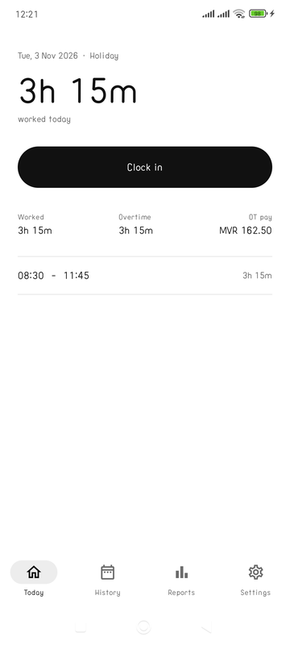
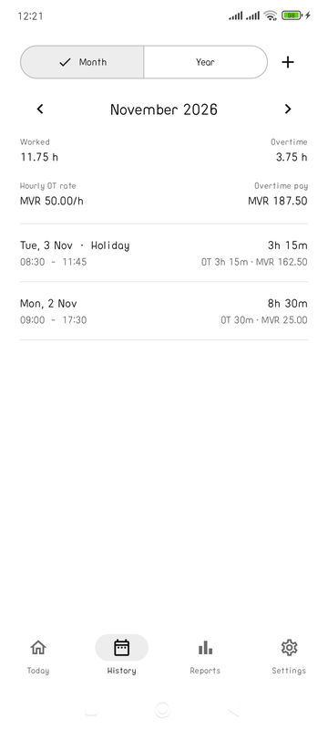
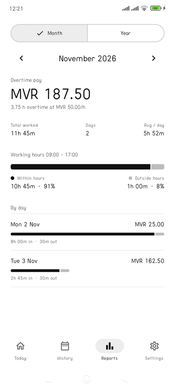
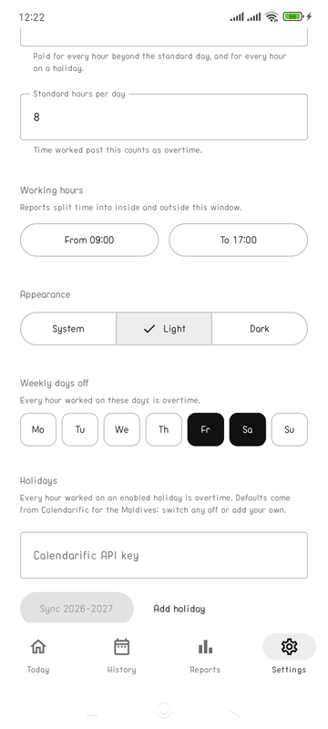
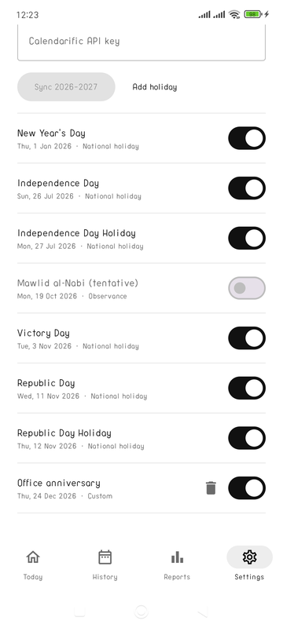
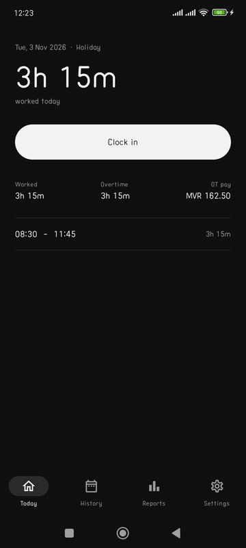
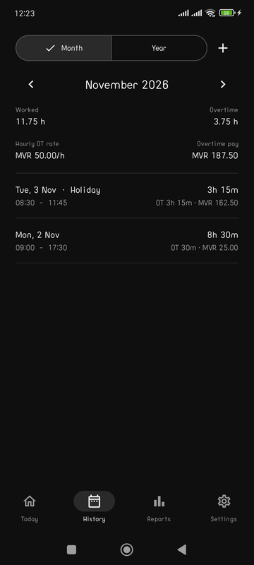
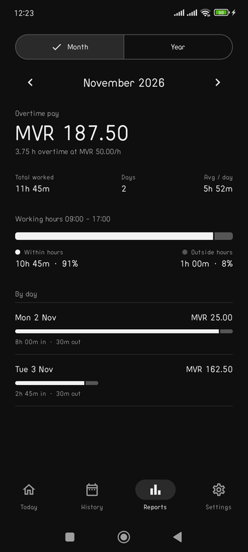
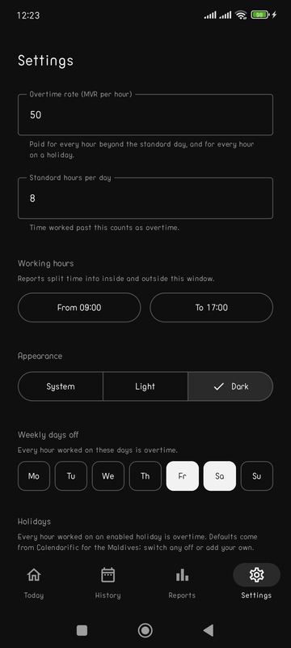
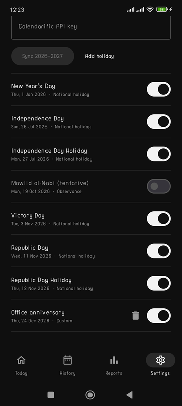

# Timity

A minimal Android time tracker for one employee: clock in, clock out, and see overtime pay.

## Screenshots

| Today | History | Reports | Settings | Holidays |
|---|---|---|---|---|
|  |  |  |  |  |
|  |  |  |  |  |

## Features

- **Today**: one-tap clock in / clock out with a live elapsed timer and today's sessions. Clocking out asks for an optional comment. Tap any session to fix its times, edit the comment, or delete an accidental clock in.
- **History**: filter by month or year, see hours worked, overtime hours, the hourly overtime rate and total overtime pay in MVR. Each entry shows its in and out times and comment. Tap one to edit or delete it, or add one manually.
- **Reports**: overtime pay for the month or year, total and average hours, time worked inside vs outside your working-hours window, and a per-day (month) or per-month (year) breakdown.
- **Settings**: overtime rate (MVR per hour), standard hours per day (anything beyond counts as overtime), working-hours window, System / Light / Dark theme, English / Dhivehi language, weekly days off (Friday and Saturday by default), and holidays.
- **Ramadan hours**: tap + next to Working hours to add a period with its own window and standard day. The dates are pre-filled from the synced calendar's Ramadan Start and Eid al-Fitr entries. A period applies only between its dates and switches back to the default hours automatically; each one can also be switched off.
- **Holidays**: every hour worked on a holiday or weekly day off is overtime. Enter a free [Calendarific](https://calendarific.com) API key and tap Sync to pull Maldives holidays for this year and next. National and public holidays are on by default; government holidays and observances are listed but off. Toggle any holiday, tap one to edit its name or date, or add your own.

## Language

The app ships in English and Dhivehi (ދިވެހި). The switch is in Settings and is stored by AndroidX AppCompat, so it survives restarts. Dhivehi strings live in `app/src/main/res/values-dv/strings.xml`; corrections are welcome.

## Stack

- Kotlin + Jetpack Compose (Material 3), AppCompat for per-app locales
- Room (SQLite) for time entries, stored on the device only
- DataStore for settings
- minSdk 26, targetSdk 36

## Build

Requires a JDK 17+ and the Android SDK (`ANDROID_HOME` set, or a `local.properties` with `sdk.dir`).

```sh
./gradlew testDebugUnitTest assembleDebug
adb install -r app/build/outputs/apk/debug/app-debug.apk
```

## Overtime calculation

Two modes, chosen in Settings:

- **Outside working hours** (default): overtime is any time before the working-hours window starts or after it ends, so clocking out after the end time counts straight away.
- **Beyond standard day**: `overtime = max(0, worked - standardHours)`, whatever the clock times.

On an enabled holiday or weekly day off, `overtime = worked` in both modes. Overtime pay is `overtime hours x rate`. Totals on the History and Reports screens sum every session in the selected month or year.

Holiday data is fetched once per sync and stored locally; the app makes no other network requests.
